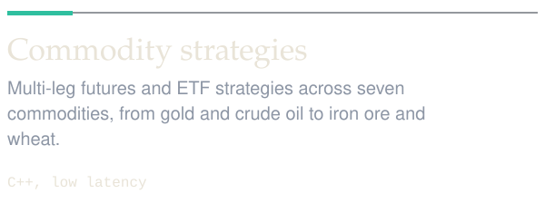
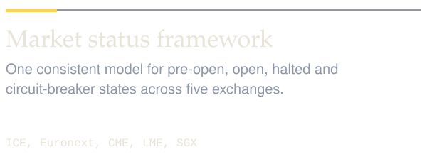
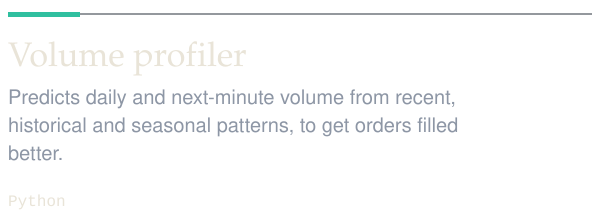
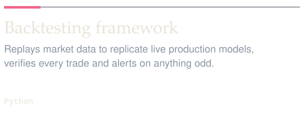
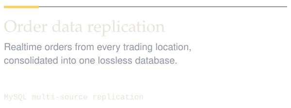
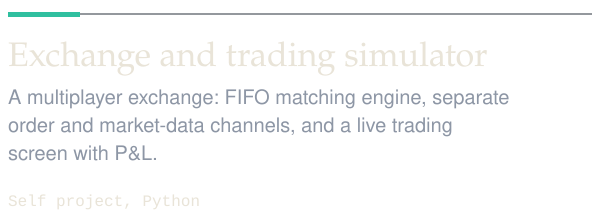
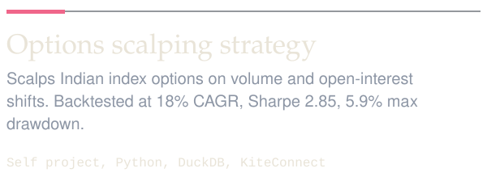

<a href="https://www.linkedin.com/in/akash-chavan007/"><picture><source media="(prefers-color-scheme: dark)" srcset="assets/hero-dark.svg"><source media="(prefers-color-scheme: light)" srcset="assets/hero-light.svg"></picture></a>

<picture><source media="(prefers-color-scheme: dark)" srcset="assets/market-dark.svg"><source media="(prefers-color-scheme: light)" srcset="assets/market-light.svg"></picture>

<a href="https://github.com/AkashChavan54/AkashChavan54/issues/new?title=order%7Cbuy&body=Press+%22Create%22+to+send+this+order.+Leave+the+title+as+it+is."><picture><source media="(prefers-color-scheme: dark)" srcset="assets/buy-dark.svg"><source media="(prefers-color-scheme: light)" srcset="assets/buy-light.svg"></picture></a>
<a href="https://github.com/AkashChavan54/AkashChavan54/issues/new?title=order%7Csell&body=Press+%22Create%22+to+send+this+order.+Leave+the+title+as+it+is."><picture><source media="(prefers-color-scheme: dark)" srcset="assets/sell-dark.svg"><source media="(prefers-color-scheme: light)" srcset="assets/sell-light.svg"></picture></a>

This book is live. Each button opens a pre-filled issue; submit it and a GitHub Action risk-checks your order, fills it and updates this page within a few minutes. It is a small cousin of the exchange simulator further down.

### The story so far

<picture><source media="(prefers-color-scheme: dark)" srcset="assets/blotter-dark.svg"><source media="(prefers-color-scheme: light)" srcset="assets/blotter-light.svg"></picture>

### What I build at work

<picture><source media="(prefers-color-scheme: dark)" srcset="assets/card-risk-dark.svg"><source media="(prefers-color-scheme: light)" srcset="assets/card-risk-light.svg"></picture>
<picture><source media="(prefers-color-scheme: dark)" srcset="assets/card-strategies-dark.svg"><source media="(prefers-color-scheme: light)" srcset="assets/card-strategies-light.svg"></picture>

<picture><source media="(prefers-color-scheme: dark)" srcset="assets/card-status-dark.svg"><source media="(prefers-color-scheme: light)" srcset="assets/card-status-light.svg"></picture>
<picture><source media="(prefers-color-scheme: dark)" srcset="assets/card-volume-dark.svg"><source media="(prefers-color-scheme: light)" srcset="assets/card-volume-light.svg"></picture>

<picture><source media="(prefers-color-scheme: dark)" srcset="assets/card-backtest-dark.svg"><source media="(prefers-color-scheme: light)" srcset="assets/card-backtest-light.svg"></picture>
<picture><source media="(prefers-color-scheme: dark)" srcset="assets/card-replication-dark.svg"><source media="(prefers-color-scheme: light)" srcset="assets/card-replication-light.svg"></picture>

### What I build for myself

<picture><source media="(prefers-color-scheme: dark)" srcset="assets/card-simulator-dark.svg"><source media="(prefers-color-scheme: light)" srcset="assets/card-simulator-light.svg"></picture>
<picture><source media="(prefers-color-scheme: dark)" srcset="assets/card-options-dark.svg"><source media="(prefers-color-scheme: light)" srcset="assets/card-options-light.svg"></picture>

### Activity

<a href="https://github.com/AkashChavan54?tab=repositories"><picture><source media="(prefers-color-scheme: dark)" srcset="assets/stats-dark.svg"><source media="(prefers-color-scheme: light)" srcset="assets/stats-light.svg"></picture></a>

<picture><source media="(prefers-color-scheme: dark)" srcset="assets/footer-dark.svg"><source media="(prefers-color-scheme: light)" srcset="assets/footer-light.svg"></picture>

<a href="https://www.linkedin.com/in/akash-chavan007/">LinkedIn</a> · <a href="https://github.com/AkashChavan54?tab=repositories">All repositories</a>

