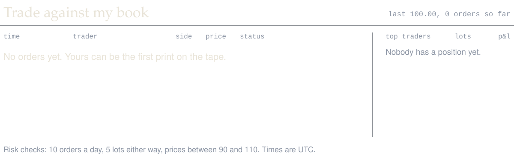
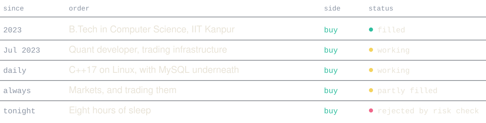
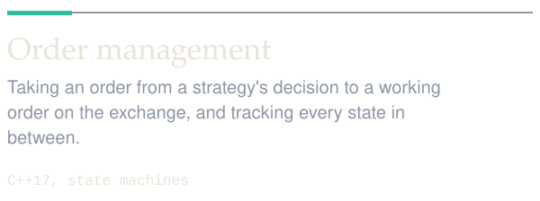
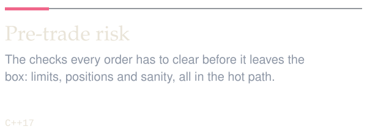
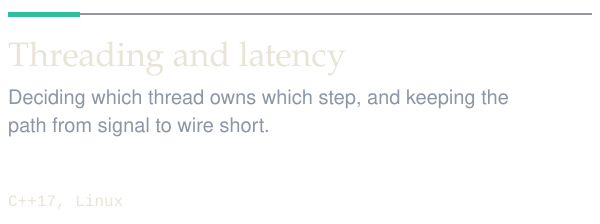
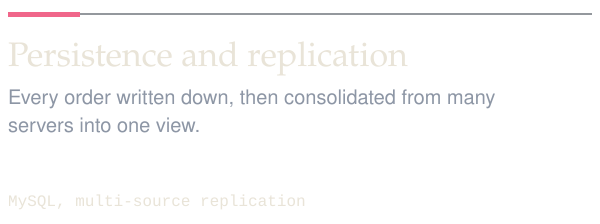
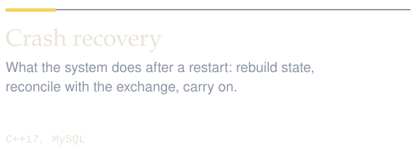
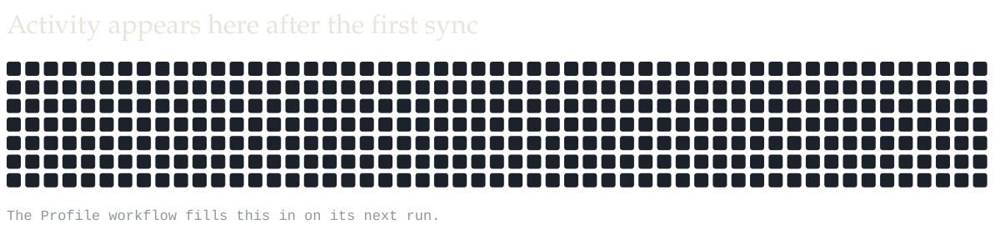

<a href="https://github.com/AkashChavan54?tab=repositories"><picture><source media="(prefers-color-scheme: dark)" srcset="assets/hero-dark.svg"><source media="(prefers-color-scheme: light)" srcset="assets/hero-light.svg"></picture></a>

<picture><source media="(prefers-color-scheme: dark)" srcset="assets/market-dark.svg"><source media="(prefers-color-scheme: light)" srcset="assets/market-light.svg"></picture>

<a href="https://github.com/AkashChavan54/AkashChavan54/issues/new?title=order%7Cbuy&body=Press+%22Create%22+to+send+this+order.+Leave+the+title+as+it+is."><picture><source media="(prefers-color-scheme: dark)" srcset="assets/buy-dark.svg"><source media="(prefers-color-scheme: light)" srcset="assets/buy-light.svg"></picture></a>
<a href="https://github.com/AkashChavan54/AkashChavan54/issues/new?title=order%7Csell&body=Press+%22Create%22+to+send+this+order.+Leave+the+title+as+it+is."><picture><source media="(prefers-color-scheme: dark)" srcset="assets/sell-dark.svg"><source media="(prefers-color-scheme: light)" srcset="assets/sell-light.svg"></picture></a>

Each button opens a pre-filled issue. Submit it and a GitHub Action risk-checks your order, fills it against the book and updates this page within a few minutes.

 

<picture><source media="(prefers-color-scheme: dark)" srcset="assets/blotter-dark.svg"><source media="(prefers-color-scheme: light)" srcset="assets/blotter-light.svg"></picture>

 

<picture><source media="(prefers-color-scheme: dark)" srcset="assets/card-orders-dark.svg"><source media="(prefers-color-scheme: light)" srcset="assets/card-orders-light.svg"></picture>
<picture><source media="(prefers-color-scheme: dark)" srcset="assets/card-risk-dark.svg"><source media="(prefers-color-scheme: light)" srcset="assets/card-risk-light.svg"></picture>

<picture><source media="(prefers-color-scheme: dark)" srcset="assets/card-routing-dark.svg"><source media="(prefers-color-scheme: light)" srcset="assets/card-routing-light.svg"></picture>
<picture><source media="(prefers-color-scheme: dark)" srcset="assets/card-threads-dark.svg"><source media="(prefers-color-scheme: light)" srcset="assets/card-threads-light.svg"></picture>

<picture><source media="(prefers-color-scheme: dark)" srcset="assets/card-storage-dark.svg"><source media="(prefers-color-scheme: light)" srcset="assets/card-storage-light.svg"></picture>
<picture><source media="(prefers-color-scheme: dark)" srcset="assets/card-recovery-dark.svg"><source media="(prefers-color-scheme: light)" srcset="assets/card-recovery-light.svg"></picture>

 

<a href="https://github.com/AkashChavan54"><picture><source media="(prefers-color-scheme: dark)" srcset="assets/stats-dark.svg"><source media="(prefers-color-scheme: light)" srcset="assets/stats-light.svg"></picture></a>

<picture><source media="(prefers-color-scheme: dark)" srcset="assets/footer-dark.svg"><source media="(prefers-color-scheme: light)" srcset="assets/footer-light.svg"></picture>
